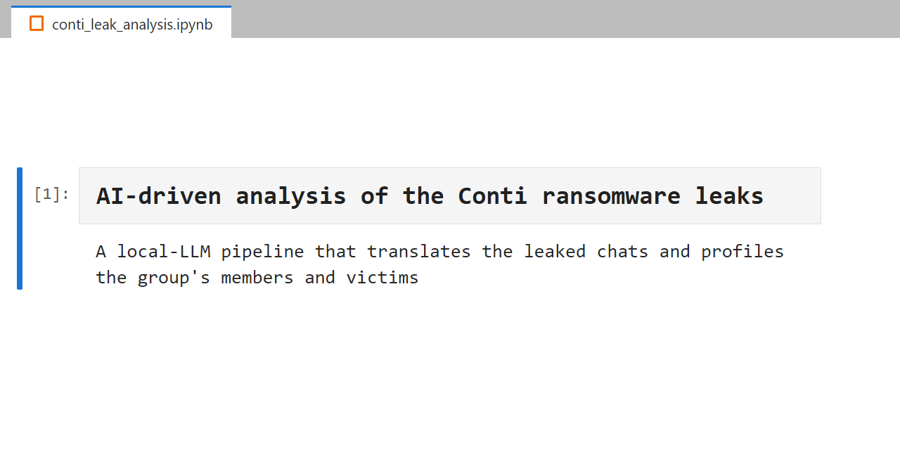
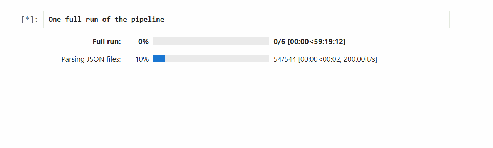
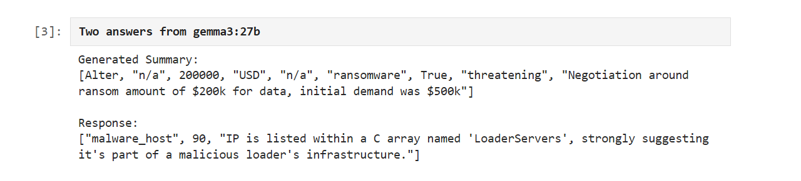
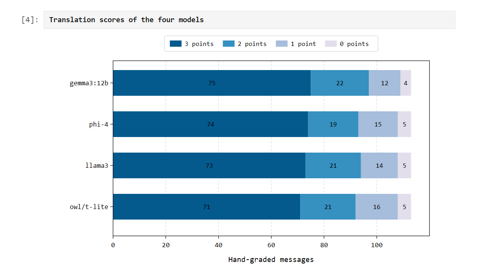
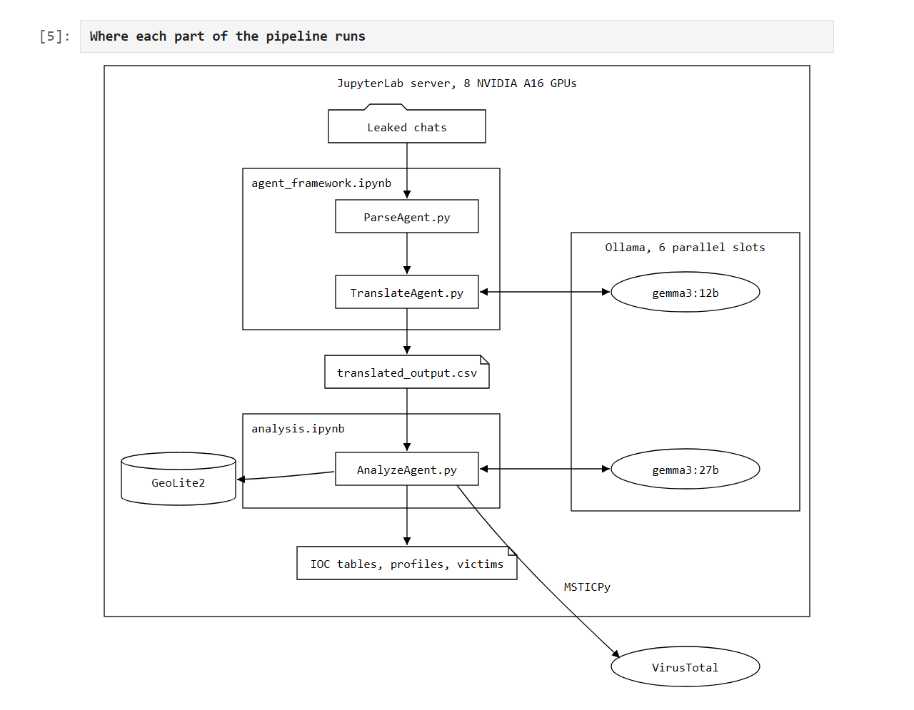
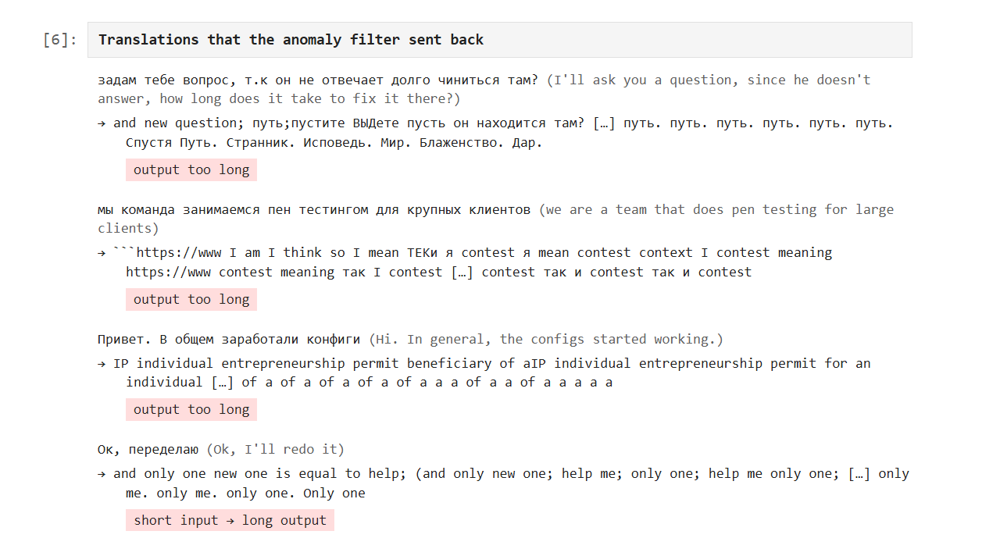

# AI-driven analysis of the Conti ransomware leaks

This is the code from my bachelor thesis. It's a pipeline on local LLMs that parses and translates the leaked chats of the Conti ransomware group, then profiles its most active members and the victims they discussed. I built and ran all of it myself, with ChatGPT helping on parts of the scripts, regexes and prompts. I first met the Conti leak in the Cybersecurity & Cybercrime minor in 2024, where my group wrote a report on it.

Solo project, University of Twente • Research Project module (12) • April to July 2025 • Archived, not maintained

> [!NOTE]
> The pipeline doesn't run from this repo alone. It needs the leaked chats, a GPU server for the local LLMs, a VirusTotal API key and the MaxMind GeoLite2 database, and none of them are included.

## Results / Demo

The pipeline took the leak from broken JSON files to English chats, IP threat data, profiles of the most active members and a table of potential victims. The whole run took about 60 hours on the university's JupyterLab server.

| Stage | Result | Paper section |
|---|---|---|
| Parsing | 168,740 messages from 544 files in 2.7 s | 4.1 |
| Model choice | gemma3:12b averaged 2.49 of 3 on 114 hand-graded messages, against 2.43 for phi-4 and llama3 and 2.40 for owl/t-lite | 4.2 |
| Pre-processing | 47,702 of 168,740 messages (28.3%) never reached the LLM, which saved about 24 hours | 4.2 |
| Translation | About 45 hours on 6 parallel workers, 1.83 s per message | 4.2 |
| Anomaly filter | 1,731 retries on 418 messages in a log of 6,897 messages | 4.2 |
| Enrichment | 6,710 IPs enriched in about 2 hours | 4.3 |
| Members | The 20 most active of 331 accounts, who sent 68% of all messages, profiled in about 5 hours | 4.4.1 |
| Member roles | About 90% agreement with KELA, Northwave, Check Point, Gihon and Arctic Wolf | 4.4.1 |
| Victims | 5,046 flagged messages, 567 rows with a victim and 144 distinct potential victims, in about 7 hours | 4.4.2 |
| Money | About $93.5M discussed, against the $104.4M that Gray et al. estimated | 4.4.2 |

## How it works

The pipeline is three Python modules in `Agents/`, which two Jupyter notebooks import and run on a JupyterLab server. The modules pass pandas tables and CSV files to each other, and every LLM call goes to models that Ollama serves locally.

The leaked chats came as files of JSON objects written back to back, so `json.loads` fails on them. `ParseAgent.py` puts a comma between every `}{` with a regex, wraps each file in brackets and loads all the messages into one pandas table.

`TranslateAgent.py` translates the messages from Russian to English with gemma3:12b and saves each translation as soon as it's done, so a crashed run resumes where it stopped. Messages that are only links, numbers or symbols are skipped, and the most common phrases are translated once and reused. The rest go through the model on parallel workers, each with its neighbors in the chat as context. Under that load the model sometimes returned repeated or invented text, so a filter retries outputs with the wrong length or leftover Cyrillic.

`AnalyzeAgent.py` pulls IP addresses, URLs, email addresses and crypto wallets out of the messages with regexes and saves each kind to its own table. It sends every IP through MSTICPy to VirusTotal for threat data and to the GeoLite2 database for location.

For the most active accounts, the same module builds a profile with every IP, email address and wallet each one mentioned. gemma3:27b then labels how each user relates to each of their IPs and writes a two-sentence summary of their personal details and likely role.

For victims, a regex flags messages about ransoms, companies and money, and gemma3:27b reads each flagged message with the conversation around it. It fills in the company, the ransom amount, the deadline and whether data was leaked, and rows without a victim are dropped.

Built with: Python 3.10.12, Jupyter, Ollama (gemma3:12b, gemma3:27b), LangChain, langchain-ollama, MSTICPy, VirusTotal, MaxMind GeoLite2, pandas, tqdm, matplotlib, squarify 0.4.4

## Project structure

| File | Purpose |
|---|---|
| [`Agents/ParseAgent.py`](Agents/ParseAgent.py) | Turns the leaked JSON files into one pandas table |
| [`Agents/TranslateAgent.py`](Agents/TranslateAgent.py) | Translates the messages, with phrase reuse, skipping, retries and resumable output |
| [`Agents/AnalyzeAgent.py`](Agents/AnalyzeAgent.py) | Extracts and enriches the IOCs, profiles the members and finds the victims |
| [`notebooks/agent_framework.ipynb`](notebooks/agent_framework.ipynb) | Runs parsing and translation |
| [`notebooks/analysis.ipynb`](notebooks/analysis.ipynb) | Runs enrichment, profiling and the victim analysis, and draws a daily message chart and a treemap of skipped messages |
| [`run_ollama_parallel.sh`](run_ollama_parallel.sh) | Starts Ollama with 6 parallel slots |
| [`requirements.txt`](requirements.txt) | Lists the Python packages |
| [`docs/thesis.pdf`](docs/thesis.pdf) | Holds the thesis paper, which is also on the [university's theses site](https://purl.utwente.nl/essays/107450) |
| [`assets/`](assets) | Holds the README images |

The code is the final version from the end of the thesis, without its commented-out experiments and one unused prompt function. I replaced the five `eval()` calls on LLM output and CSV strings with `ast.literal_eval()`, cleared the notebooks' outputs and added `requirements.txt`.

#### Not included in this archive

- The leaked chats and everything made from them: translations, IOC tables, enrichment results, member profiles and victim tables. They hold real people's messages, handles and contact details.
- The VirusTotal API key and the MSTICPy config that holds it, because the key is personal.
- The MaxMind GeoLite2 database, which has its own license.
- The slides from the thesis presentation, which show real chat accounts and messages from the leak.

## Known issues and limitations

- Under parallel load the LLM sometimes garbled its output or stalled, and the cause is still open (Appendix C of the paper shows examples).
- The member summaries mix real findings with some wrong or invented details, so they're leads for an investigator to check against other sources.
