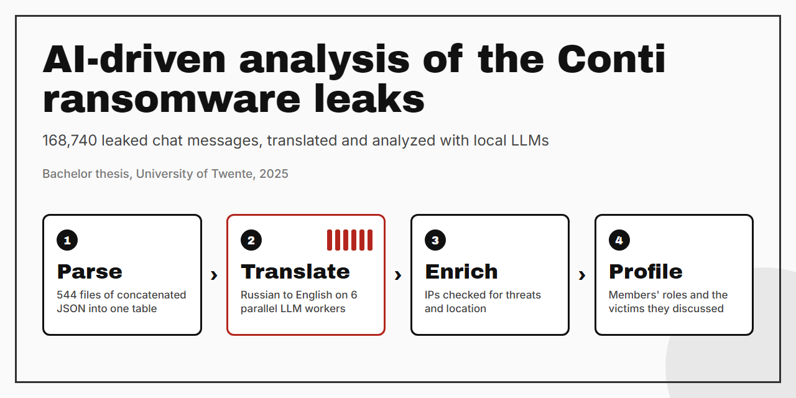
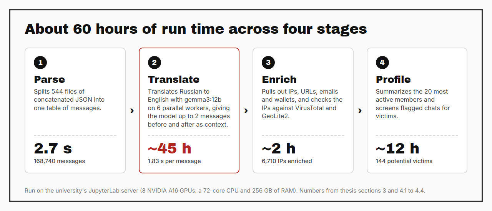
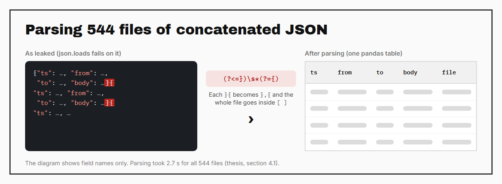
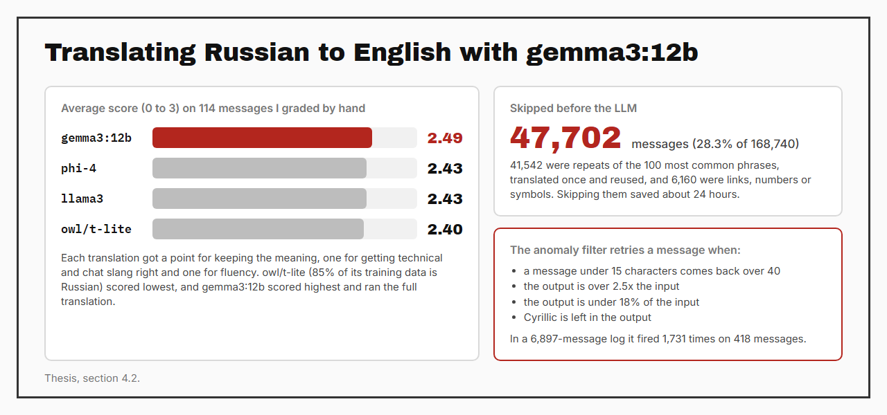
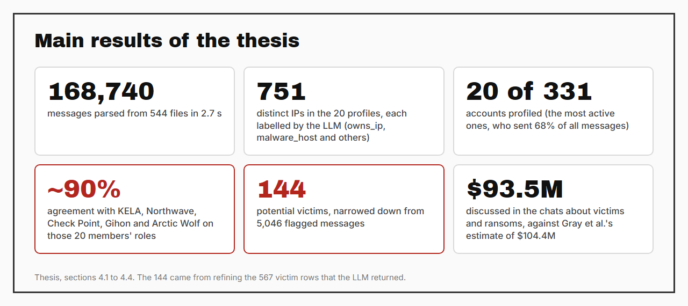

# AI-driven analysis of the Conti ransomware leaks

This is the code from my bachelor thesis. It's a pipeline on local LLMs that parses the leaked chats of the Conti ransomware group, translates them from Russian, enriches the IPs in them and profiles the group's most active members and the victims they discussed. I built and ran all of it myself. I first met the Conti leak in the Cybersecurity & Cybercrime minor in 2024, where my group wrote a report on it, and I came back to it for the thesis.

Bachelor thesis, Technical Computer Science, University of Twente · module 12, May to July 2025 · solo

> [!NOTE]
> This repo is an archive of the research code and it doesn't run as it is. The pipeline needs the leaked chats, the university's GPU server, a VirusTotal API key and the MaxMind GeoLite2 database, and none of those are in here.

## Demo

The pipeline ran once over the whole leak on the university's JupyterLab server, and these are its four stages with how long each one took.

## How it works

The leaked chats came as 544 files, each a run of JSON objects written back to back, so `json.loads` fails on them. `ParseAgent.py` puts a comma between every `}{` with a regex, wraps each file in brackets and loads everything into one pandas table.

`TranslateAgent.py` translates the messages from Russian to English. Before the full run I compared four local models on 114 messages that I graded by hand, and gemma3:12b scored highest. The 100 most common phrases get translated once and reused, and messages that are only links, numbers or symbols are skipped, which took 47,702 of the 168,740 messages out of the LLM's queue. The rest went through gemma3:12b on 6 parallel workers, each message with up to 2 messages before and after it as context. Under that load the model sometimes returned repeated or invented text, so a filter checks every output and retries the message when the length is off or Cyrillic is left in it. Each translation is written to disk as soon as it's done, so a crashed run picks up where it stopped.

`AnalyzeAgent.py` does the rest with gemma3:27b. It pulls IPs, URLs, email addresses and crypto wallets out of the messages with regexes, and sends the IPs through MSTICPy to VirusTotal for threat data and to GeoLite2 for location. For the 20 most active accounts it builds a profile with everything each one mentioned, has the LLM label how the user relates to every IP, and writes a two-sentence summary of personal details and likely role. For victims, a regex flags messages about ransoms, companies and money, and the LLM reads each flagged message with the conversation around it and fills in the company, the amount, the deadline and whether data was leaked.

## Results

| Stage | Result | Thesis section |
|---|---|---|
| Parsing | 168,740 messages from 544 files in 2.7 s | 4.1 |
| Model choice | gemma3:12b averaged 2.49 of 3 on 114 hand-graded messages (phi-4 and llama3 2.43, owl/t-lite 2.40) | 4.2 |
| Skipping | 47,702 of 168,740 messages (28.3%) never reached the LLM, which saved about 24 hours | 4.2 |
| Translation | About 45 hours on 6 workers, 1.83 s per message | 4.2 |
| Anomaly filter | 1,731 retries on 418 messages in a log of 6,897 messages | 4.2 |
| Enrichment | 6,710 IPs enriched in about 2 hours | 4.3 |
| Members | The 20 most active of 331 accounts (68% of all messages), with roles that matched KELA, Northwave, Check Point, Gihon and Arctic Wolf in about 90% of cases | 4.4.1 |
| Victims | 5,046 flagged messages, 567 rows with a victim and 144 distinct potential victims | 4.4.2 |
| Money | About $93.5M discussed, against the $104.4M that Gray et al. estimated | 4.4.2 |

The member summaries also contained wrong and invented details, so every result still needed a person to check it against other sources. Under parallel load the LLM threads stalled as well (627 timeouts in the same 6,897-message log, at least 7.8 hours of combined thread time), and the thesis leaves the cause unresolved.

## My part

The thesis was solo, so the research questions, the pipeline, the runs on the university server and the evaluation are all mine, including grading the 114 test translations. ChatGPT helped me write and refine parts of the scripts, the regexes and the prompts, as the thesis says in its AI statement.

## What's in here

| File | Purpose |
|---|---|
| [`Agents/ParseAgent.py`](Agents/ParseAgent.py) | Turns the 544 files of concatenated JSON into one pandas table |
| [`Agents/TranslateAgent.py`](Agents/TranslateAgent.py) | Phrase reuse, skipping, parallel translation with context, the anomaly filter, retries and resumable output |
| [`Agents/AnalyzeAgent.py`](Agents/AnalyzeAgent.py) | IOC extraction, MSTICPy enrichment, member profiles, IP labels and the victim analysis |
| [`notebooks/agent_framework.ipynb`](notebooks/agent_framework.ipynb) | Runs parsing and translation |
| [`notebooks/analysis.ipynb`](notebooks/analysis.ipynb) | Runs enrichment, profiling and the victim analysis, and draws two of the thesis figures |
| [`run_ollama_parallel.sh`](run_ollama_parallel.sh) | Starts Ollama with parallel slots (the file says 8, and the final run used 6) |
| [`assets/`](assets) | The images in this README |

The code is the final version from the end of the thesis with the commented-out experiments taken out. I replaced the five `eval()` calls, which ran on LLM output and on strings read back from CSV, with `ast.literal_eval()`, and the notebooks have their outputs cleared.

## What's not here

- The leaked chats and everything made from them: translations, IOC tables, enrichment results, member profiles and victim tables. They hold real people's messages, handles and contact details.
- The VirusTotal key, the MSTICPy config and the MaxMind GeoLite2 database, which has its own licence.
- An older notebook whose saved outputs contain chat data.
- The thesis PDF, which the university hosts.

## Documents

- [The thesis on the University of Twente's student theses site](https://purl.utwente.nl/essays/107450)
